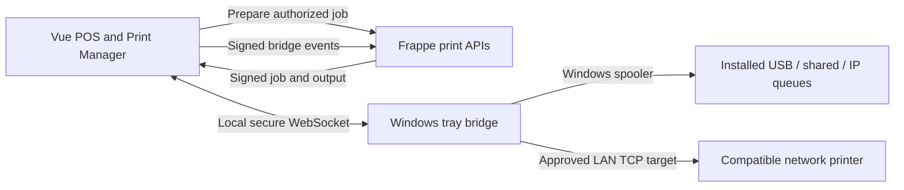

# POS Print Manager and Windows Print Bridge Plan

**Status — 2026-11-22:** The POS integration is implemented with the supplied private `@esafe/printer-manager` **0.1.0** SDK and the independently developed Rust/Tauri Windows manager. See [implemented behavior, deployment, cashier setup, testing and rollback](esafe-print-manager.md). Native acceptance is distinct from physical paper output; the unsigned development installer and real printers still require qualification.

The original proposal below is retained as historical planning. Its suggested .NET bridge, server-signed intent protocol, proposed records and signed-installer assumptions are not the implemented SDK contract. The POS uses SDK browser identity/signing, secure loopback ports 17651–17660, exact printer scopes and the existing Printing workspace. It does not implement an alternate WebSocket protocol or new browser IP discovery. QZ was removed from this POS before integration.

**Related work:** [Label Printing Module plan](label-printing-module-plan.md).

## 1. Recommended solution

Build two cooperating modules:

1. **POS Print Manager:** Configure printing, assign printers to purposes, run tests, show connection problems and inspect print jobs inside the existing Vue POS.
2. **ESAFE Print Bridge for Windows:** An installed tray application that accepts authorized jobs through a local WebSocket connection, enumerates Windows printer queues and prints through Windows or directly to an approved network printer.

Make the separate manager's bridge the preferred adapter for enrolled Windows tills after validation. Keep browser printing and the existing server-network adapter available during migration. Select one adapter for each job and record it before dispatch.

The bridge solves the cloud-to-shop connectivity problem: the POS browser talks to its own Windows computer, and that computer reaches USB or shop-network printers. Frappe continues to control permissions and supply authoritative business data.

“Find all printers” means enumerate the queues installed for the active Windows user, including USB, shared and installed IP printers. It does not mean discovering every powered-on network device or automatically supporting every printer language. Offer manual IP setup first and supported network discovery later.

## 2. Current repository baseline

The baseline below reflects the QZ removal on 2026-11-22. The external manager and its POS integration are future work.

| Existing module | Current behavior | Planned integration |
|---|---|---|
| `frontend/src/components/ReceiptModal.vue` | Chooses server-network or browser/ERPNext Print Format printing | Call one print-job coordinator; preserve receipt and reprint permission checks |
| `frontend/src/receiptPrint.js` | Browser receipt measurement and print rendering | Retain browser fallback and offline receipt printing |
| `esafepos/api/printing.py` | Builds ESC/POS receipts and sends TCP from the Frappe server | Reuse authoritative receipt rendering; retain explicitly configured server-network installations |
| `frontend/src/labels/printing.js` | Browser, PDF export and native label-output helpers | Use Print Manager bindings and a bridge adapter without changing label geometry |
| `esafepos/api/labels.py`, label preset/job DocTypes | Scoped presets, frozen label jobs and results | Reuse label business records and authorization; link delivery records rather than duplicate snapshots |
| POS Profile printer IP/port and Print Format | Existing outlet choices | Import as suggestions; explicitly select execution location and adapter |

The existing TCP socket opens on the **Frappe server**, not the cashier computer. A private shop printer is normally unreachable from a cloud server. The new direct-IP adapter opens that socket on the Windows till instead.

## 3. Architecture and ownership

| Layer | Owns |
|---|---|
| Frappe | Company/outlet permissions, source-document access, job authorization, original/reprint rules, shared defaults and audit history |
| Vue | Operator workflow, previews, local bridge connection and display of observed job state |
| Windows bridge | Local printer enumeration, approved device bindings, output adapters, durable dispatch journal and local diagnostics |
| Printer profile | Verified capabilities: language, dimensions, resolution, printable area and optional cutter/drawer controls |
| Label module | Stock/design geometry, item/price snapshots, copies, calibration inputs and label-specific reprints |

Use a protocol and schema version independent of the POS release. Expose supported protocol versions, renderer versions and adapters in the bridge handshake; reject incompatible jobs before sending any printer bytes.

## 4. POS Print Manager workflow

Integrate the separate manager into the existing **Printing → Printers** section. Keep Labels and Receipt available in the same workspace, using existing POS styles, translations, permission patterns and responsive navigation.

| Area | Operator behavior |
|---|---|
| Connection | Show bridge installation/running/pairing state, version, last successful contact and a specific recovery action |
| Printers | Refresh installed queues, inspect reported details, add an IP target, give it an outlet-friendly name and print a test |
| Assignments | Choose independent destinations for receipts, labels, A4 invoices/documents and reports |
| Profiles and calibration | Set paper/media, supported output language, exact DPI/dots per mm, margins, orientation and measured offsets |
| Jobs | Show source, purpose, printer, adapter, copies, last known state, error and explicit reprint action |
| Diagnostics | Check bridge connection, queue availability, approved network reachability and print a bounded diagnostic page |

Example assignments on one till: **Counter receipt → USB receipt queue**, **Price labels → label queue**, **Invoices → office A4 queue**. Another till can use different physical queues for the same logical purposes.

Setup sequence:

1. A manager enables Print Manager and installs the signed Windows package.
2. The installer configures local connection trust and starts the tray application for the intended Windows user.
3. The manager pairs the exact POS site with that bridge through a visible native confirmation.
4. Print Manager lists installed queues; the manager selects a verified profile or adds an approved IP endpoint.
5. Print a measured test, save the purpose assignment and verify the first real receipt.

Browser local-network permission, certificate trust, native site pairing and POS user authorization are separate checks. Show each failure separately. Silent printing becomes available after setup succeeds; browser or OS policy can still require setup consent.

## 5. Printer discovery and compatibility

### Installed Windows queues

Use the Windows spooler APIs in the active user's context. Start with `EnumPrinters` using `PRINTER_ENUM_LOCAL | PRINTER_ENUM_CONNECTIONS` and level 4, then load detailed information asynchronously for selected queues. Microsoft documents the fast level-4 listing and the potential delay of remote level-2 queries. See [EnumPrinters](https://learn.microsoft.com/en-us/windows/win32/printdocs/enumprinters).

List disconnected queues as installed but unavailable/unknown, and distinguish virtual printers that may open dialogs. USB, Bluetooth, WSD and shared printers are usable when Windows has a suitable accessible queue/driver. Driver installation remains a Windows setup step.

Return bridge-scoped opaque target IDs plus display names, driver/port details where available, reported status, capability source and last check time. Names and ports can change; invalidate a changed binding and ask for a new test instead of silently choosing a similarly named queue. Do not change the Windows default printer.

### Direct IP printing

First release: **Add network printer** with IP address, permitted port, printer language and profile. Default to TCP 9100 only for a compatible raw printer. Send from the Windows bridge; require no inbound shop firewall opening or public printer exposure.

Installed Windows TCP/IP queues should ordinarily use the spooler adapter. Direct IP is useful when raw-compatible equipment has no installed Windows queue. Detect likely duplicate destinations and show their different routes without silently merging them.

Later discovery may use supported mDNS/DNS-SD or device protocols on selected interfaces. Make discovery explicit, bounded and cancelable. Do not promise discovery across VLANs or automatic identification from an open TCP port. IPP/IPPS printing is a separate adapter and does not become supported by adding a 9100 connection.

## 6. Output adapters and purposes

Keep **transport**, **printer language** and **document purpose** separate. A network port does not establish whether a printer understands ESC/POS, ZPL, TSPL, PDF or another language.

| Adapter | Intended output | Delivery |
|---|---|---|
| Windows raw spooler | Server-authored ESC/POS receipts on verified queues | First production bridge release |
| Direct LAN raw TCP | The same ESC/POS receipts to approved compatible IP endpoints | First production bridge release |
| Windows driver rendering | Validated label scenes rendered at known physical dimensions and device resolution | Next phase after geometry proof |
| Windows document rendering | Server-generated PDF for ERPNext Print Formats and A4 documents | Document phase after renderer proof |
| Native label output | Verified ZPL/TSPL and other justified languages through queue or IP | Later, one tested adapter at a time |
| Existing browser/server-network | Existing supported workflows during migration | Retain |

Raw spooler output uses the appropriate `OpenPrinter` / `StartDocPrinter` / `WritePrinter` / `EndDocPrinter` lifecycle with cleanup, abort handling and correct partial-write processing. Raw data must already be in a language the destination understands. Arbitrary PDF/HTML is not a universal raw-print format; render documents through the selected driver path. See [WritePrinter](https://learn.microsoft.com/en-us/windows/win32/printdocs/writeprinter).

Receipts reuse `get_receipt` and `build_receipt_bytes` initially, preserving calculated totals, receipt options and existing barcode behavior. Test 58 mm and 80 mm separately. Raster/text shaping for Sinhala, Tamil, Arabic, logos and unsupported code pages is a separate rendering capability; enumerate it honestly per profile.

For bridge labels, Frappe validates and freezes a versioned declarative scene derived from the existing label snapshot, then signs its digest. A deterministic bridge renderer consumes that scene, including physical dimensions, device-dot placement and embedded approved images. Reject unsupported scene/renderer versions. Do not authorize arbitrary browser-supplied PDF or native bytes merely because they reference a valid label job. Prove parity with the existing label preview before enabling this route.

For A4/ERPNext Print Formats, prepare authorized PDF output on the server, then render it through a packaged, licensed and tested Windows renderer. Do not depend on the user's default PDF viewer, shell print verbs or unattended browser print dialogs.

Only expose cut, feed, darkness, speed or cash-drawer controls when the selected profile supports them. Drawer opening needs a separately authorized intent or an explicitly authorized sale-print action; it must not be triggered by reconnect, printer discovery or a routine diagnostic receipt.

## 7. Windows application and installation

Recommended implementation: **C# on .NET 10 LTS**, a small WinForms tray shell, ASP.NET Core/Kestrel for the local WebSocket endpoint, Winspool interop for raw queues and SQLite for the dispatch journal. .NET 10 is an active LTS line in the [Microsoft support policy](https://dotnet.microsoft.com/en-us/platform/support/policy/dotnet-core); select the current supported patch at build time.

- Start with supported Windows 11 x64 configurations and current Chrome/Edge. Assess actual Windows 10 editions, servicing status, older till CPUs and x86/ARM64 needs before adding a support claim.
- Ship a signed installer and self-contained runtime. Signing and distributing the separate manager requires its own release process.
- Run as the logged-in Windows user, with opt-in startup at login and no elevation for ordinary printing. This keeps access aligned with that user's printer queues and network-share credentials.
- Initial deployment supports one active Windows user/session per till. Fast-user switching, RDP multi-session and shared services need a separate endpoint/identity design before support.
- Tray controls: status, paired sites, pause accepting new jobs, local diagnostics, restart and remove pairing.
- Bind only loopback addresses. No LAN listener, remote browser printing or phone-to-PC printing in the initial release.
- Use a configured loopback port, for example `18443`, with explicit conflict detection. It is an application configuration choice, not an assigned standard port. POS deployment CSP must allow the approved `wss:` endpoint.
- Keep local secrets protected with Windows user-scoped protection/certificate storage and restrictive file permissions. Isolate configuration and journal data by installation and paired site.
- Verify signed update metadata and package signatures; stage updates outside active dispatch and retain a recovery path. Self-contained runtime security updates require rebuilding the package.

### Secure local connection is an early proof requirement

Target `wss://localhost:<configured-port>/v1` from the HTTPS POS. Standard browser WebSockets need browser-trusted TLS; application pairing cannot replace certificate validation or pin a self-signed certificate through the JavaScript constructor.

The installer must provision a unique local TLS identity with the correct localhost/loopback subject names and a tested Windows/browser trust path. If a local trust anchor is required, make it unique to this installation, keep issuer authority out of the running bridge, document its scope, and remove only installer-owned trust on uninstall. Specify renewal, expiry warnings, repair and rollback before production. Never distribute one shared localhost private key or instruct users to disable browser security.

Chrome documents local-network/loopback permissions that also affect WebSockets. Validate actual stable Chrome and Edge behavior, including managed policies, denied permission and expiry/renewal. WSS does not remove that permission requirement. See [Chrome Local Network Access guidance](https://developer.chrome.com/docs/modern-web-guidance/guides/security/local-network-access). Do not base compatibility on one browser's allowance for insecure loopback WebSockets.

## 8. Pairing, authentication and job authorization

### Site and device enrollment

1. The bridge creates a random installation ID and a device signing key. It exposes only a minimal pairing challenge before authentication, never printer inventory.
2. A manager signs into the intended HTTPS POS and starts a short-lived, rate-limited pairing request bound to the bridge ID/key and a fresh nonce.
3. The native tray confirmation displays the exact HTTPS site, device identity and matching verification code. The manager confirms it locally.
4. The bridge retrieves the site's bridge verification key through normal validated HTTPS from the confirmed origin and pins it for that pairing. Pairing cannot silently accept an arbitrary caller's key or a replacement key supplied with a print job.
5. Frappe registers the device and permitted company/POS Profiles. The bridge stores the paired origin/key and approved bindings; removal or key rotation requires a defined authenticated procedure.

Do not send ERPNext passwords, browser session cookies or reusable ERP API keys to the bridge. Use purpose-specific per-site server signing keys with key IDs, rotation and protected private-key storage.

### Runtime connection

Reject unapproved `Origin`, unexpected `Host`, non-loopback connections and missing/null origins. Use exact scheme/host/port matches, not domain suffixes or wildcard origins. CORS is not WebSocket authorization, and origin validation alone is not authentication, as explained in [ASP.NET Core WebSocket security guidance](https://learn.microsoft.com/en-us/aspnet/core/fundamentals/websockets?view=aspnetcore-10.0#websocket-origin-restriction).

After connection, the bridge supplies a fresh nonce. The signed, short-lived session grant binds that nonce to the site, device key fingerprint, current POS user, allowed profiles and operations. Require authorization as the first substantive message with a short timeout. No inventory, configuration or job operation is allowed before it succeeds. Browser WebSockets cannot rely on arbitrary custom authentication headers; carry the grant in the first message, never a URL query.

### Print authorization

Frappe creates each print intent after checking the feature switch, company/outlet scope, source-document access, operation permission and current device/binding approval. A caller-provided `reprint=false` flag cannot establish entitlement to an original receipt: enforce original issuance and additional-copy/reprint rules on the server, including concurrent tabs and requests through other adapters.

Issue the original entitlement from the authorized sale-finalization flow, with an atomic uniqueness rule per source/purpose. Route new browser/server-network receipt attempts through that same coordinator as they migrate. Historical invoices without a delivery journal must use the existing reprint rule; absence of a journal row is not evidence that they have never been printed.

Sign a bounded manifest covering the job ID, source revision/snapshot, purpose, user, site, POS Profile, device ID/key, binding and configuration revision, adapter, language/renderer version, ordered part hashes, exact quantities/copies, drawer/cutter intent, issuance/expiry times and nonce. The bridge independently verifies the signature, pairing, binding and limits before dispatch. Begin with a short authorization lifetime, such as 60 seconds, and reject expired new submissions; accepted jobs remain queryable after expiry.

Use server-authored receipt bytes, server-generated document PDF or the authorized label scene described above. Never provide a generic “sign these bytes” endpoint. Forbid file paths, executable commands, arbitrary URLs and unconstrained socket destinations in print messages. Assets must be bounded embedded data or explicitly authorized content, not arbitrary bridge-side URL fetches.

Direct-IP configuration is a manager operation saved to a device allowlist. Validate destination IP/subnet, protocol and port; reject loopback, metadata/link-local, multicast and public destinations by default. If hostnames are later supported, validate every resolved destination and prevent DNS changes from bypassing the allowlist. The bridge must not become an arbitrary network relay.

Revocation blocks new server grants immediately. An offline bridge can only enforce revocation information it has received; bound that exposure with short online grants. Logout clears the browser session connection and grants. Show queued/accepted jobs separately because revocation cannot retrieve bytes already delivered to a printer.

## 9. Local protocol contract

Use strict versioned JSON control messages and bounded payload transfer. Start with explicit limits, for example a 64 KiB control message and a 1 MiB decoded receipt. Set scene/PDF page, image-pixel, total-byte, queue-depth and copy limits before enabling those adapters. Reject an oversized part before any output; never silently remove limits to accommodate a larger job.

| Operation | Responsibility |
|---|---|
| `hello` / `session.authorize` | Negotiate protocol, challenge and scoped session grant |
| `printers.list` / `printers.details` | Enumerate authenticated local inventory and reported capabilities |
| `bindings.configure` | Apply a signed manager-approved binding/configuration revision |
| `printers.test` | Submit an authorized bounded test through the ordinary job pipeline |
| `jobs.submit` | Validate manifest and all parts, journal once, then dispatch |
| `jobs.get` / `jobs.subscribe` | Recover current state and stream ordered updates |
| `jobs.cancel` | Cancel unsubmitted bridge jobs or request supported spooler cancellation |
| `diagnostics.get` | Return bounded, redacted connection/adapter diagnostics |

All operations carry request IDs; jobs also carry immutable job IDs and part numbers. Responses contain stable error codes, a useful operator message and retry classification. Sign bridge result events with device identity and sequence numbers so Frappe can validate forwarded events and reject duplicates. Never log session grants, private keys or complete receipt payloads in normal diagnostics.

## 10. Queue, duplication and failure handling

Keep a durable local journal scoped by site, device, job and part. Persist intent **before** external dispatch. Record the payload hash, binding/configuration revision, observed bytes/part progress, Windows spooler job ID where available and result events. Serialize jobs per physical destination to prevent interleaved raw commands; allow independent printers to progress separately. Known aliases of the same physical target share a dispatch lock.

Suggested states: **Prepared → Accepted → Dispatching → Submitted**, followed by **Spooler reported complete**, **Failed**, **Canceled** or **Outcome unknown** when observed. Use **Device confirmed complete** only for a tested protocol that provides reliable correlated physical completion. Label/browser adapter states can map to this journal without rewriting the original label snapshot.

| Observation | Correct behavior |
|---|---|
| Same ID and same payload/configuration | Return existing state; do not dispatch again |
| Same ID with a changed payload/configuration | Reject the collision |
| Bridge disconnected before acceptance | Query/reconnect and resubmit only the same ID; the bridge still deduplicates |
| Bridge accepted a job and the browser disconnects | Continue the accepted job; recover state on reconnect |
| Confirmed no bytes/spooler submission occurred | Mark a pre-dispatch failure; allow a controlled retry or explicit alternate adapter |
| Timeout/crash after possible spooler or TCP submission | Mark outcome unknown; reconcile available evidence and require operator action before another print |
| Paper out or offline after Windows accepted the job | Show the queue problem; do not create a second job automatically |
| One part of a label run may have printed | Display known part progress; let an authorized operator select the missing range for a linked reprint |
| Cancellation after bytes left the bridge | Report cancellation requested/uncertain; do not promise physical cancellation |

A completed TCP send, accepted spooler call or disappeared queue entry does not prove paper output. Microsoft explicitly describes `JOB_STATUS_COMPLETE` as sent to the printer but potentially not yet printed; see [JOB_INFO_2](https://learn.microsoft.com/en-us/windows/win32/printdocs/job-info-2).

There is an unavoidable crash window between physical submission and journaling its acknowledgement. Deduplication limits repeated dispatch but cannot guarantee exactly-once physical printing. Do not automatically switch to the browser or another printer after an ambiguous failure. An operator-approved reprint creates a new linked ID and follows existing receipt/label reprint rules.

On restart, replay result notifications, not print bytes from an interrupted dispatch. In the first release, unstarted jobs left across a restart require operator review rather than surprise printing. Use bounded journal storage, retain deduplication metadata across the authorization/recovery window and distinguish Windows' own continuing spooler queue from bridge resubmission.

## 11. Persistence and permissions

These records are proposed for implementation; this plan adds no schema.

| Record | Proposed responsibility |
|---|---|
| `EsafePOS Print Device` | Installation ID/public key, paired site, allowed company/POS Profiles, version, status and last reported contact |
| `EsafePOS Printer Profile` | Reusable capability/settings schema for a verified printer/output combination |
| `EsafePOS Print Binding` | Device-scoped logical purpose, profile, opaque local target ID, allowed adapter and configuration/calibration revision |
| `EsafePOS Print Job` | Delivery intent, source reference, snapshot digest, adapter, quantities, reprint linkage, result sequence and audit state |
| Existing `EsafePOS Label Preset` / `EsafePOS Label Print Job` | Keep label stock/design/defaults and frozen label business data; reference the delivery job |

Use a versioned reference/migration from label `Printer` presets to shared printer profiles when that adapter ships; do not maintain two independent printer selections or move measured calibration between devices. Store physical destinations, local trust material and dispatch data in the bridge. Sync only the approved binding identity/revision and necessary configuration; never return local secrets to Vue or Frappe.

Add an independent `enable_print_manager` switch. Reuse `can_reprint`, label printing permissions and existing document/report permissions. Add narrowly scoped device/profile management and print-job visibility capabilities. Managing printers must not grant receipt reprinting or source-document access. Enforce scope in APIs and DocType validation, including direct Desk writes.

Keep first-release remote device status explicitly **last reported**: the local browser forwards heartbeats/events while connected. The bridge has no persistent cloud command channel, and a manager viewing another computer cannot submit jobs to that computer's localhost endpoint.

Freeze business data once in the existing source job/document snapshot. Store delivery metadata separately. Printing must not post invoices again, move stock or change prices. Define configurable audit/payload retention with bounded local disk usage; delete transient payloads when no longer needed while retaining minimal duplicate-detection and reprint linkage metadata.

## 12. Offline behavior

First custom-bridge release: preparing new bridge jobs requires online Frappe authorization. Preserve existing offline browser receipt printing and clearly show that adapter. Accepted bridge or Windows-spooled jobs may finish when internet access is lost; this is different from authorizing a fresh offline job.

Do not silently defer physical printing until reconnection or automatically reprint an offline sale when it syncs. New online job signatures cannot be issued while disconnected. Offline receipt IDs and online invoice IDs must retain their linkage so synchronization does not create another original print entitlement.

A later offline bridge phase may use a manager-enabled, device-bound, short-lived lease restricted to local offline sales, approved profiles, quantities and printer operations. It needs its own monotonic journal, tamper/replay controls, clock-rollback handling and reconciliation audit. Cached prices or labels must display data age. Defer this capability until those controls and the existing offline permission rules are tested.

## 13. Implementation boundaries

| Location | Planned work |
|---|---|
| `frontend/src/views/PrintManagerView.vue` | Printer setup, assignments, jobs and diagnostics |
| `frontend/src/components/printing/` | Connection status, printer details, setup/test forms and job state presentation |
| `frontend/src/printing/` | Versioned bridge client, common coordinator and adapter wrappers |
| `frontend/src/stores/printing.js` | Active device, capability/status cache and current job state |
| Existing receipt, label, report and document components | Submit purpose-specific intents through the coordinator as their adapters become supported |
| `esafepos/api/print_manager.py` | Scoped enrollment, profiles/bindings, intent preparation, result ingestion and reprints |
| `esafepos/printing/` | Pure manifest/schema validation, authorization policy helpers and output preparation |
| `esafepos/esafepos/doctype/` | Proposed device, profile, binding and delivery-job records |
| Separate Print Manager project | Tray host, loopback protocol, Windows/network adapters, journal and installer; developed outside this POS integration change |
| `docs/` | Installation, supported-device matrix, troubleshooting, protocol and logbook updates |

Frappe endpoints should be purpose-specific: `prepare_receipt_job`, `prepare_label_delivery`, `prepare_document_job`, `prepare_test_job`, `enroll_device`, `save_binding`, `record_events` and `create_reprint`. Mutations require authenticated POST requests with normal Frappe protections. Python additions must preserve the repository's Python 3.7 syntax requirement.

Document the separate manager's license and renderer/dependency redistribution terms before packaging. Establish its own source and signing credentials.

## 14. Delivery phases and completion gates

| Phase | Deliverable | Required evidence |
|---|---|---|
| 0. Connection and hardware proof | Signed-installation prototype, trusted WSS, native pairing, Windows enumeration, one USB/queue receipt and one direct-IP receipt | HTTPS POS works in stable Chrome/Edge without security bypass; denied permission/origin fails safely; actual model/driver/language recorded |
| 1. Receipt MVP | Print Manager setup and purpose binding; 58/80 mm ESC/POS through queue/IP; bounded tests; server-authorized jobs; durable journal; explicit reprints; diagnostics and signed installer | Correct totals/receipt barcode, permission isolation, crash/reconnect/duplicate behavior and install/repair/uninstall checks on real tills |
| 2. Label integration | Existing label workflow selects the same device bindings; signed scenes, Windows renderer and stock-specific calibration | Single/double/triple rows, gaps, measured alignment, first/last-row scanner checks and partial-reprint behavior match label snapshots |
| 3. Documents and reports | Authorized ERPNext Print Format PDF, A4 invoices and selected reports | Fonts, page dimensions, pagination, access checks and verified driver rendering; unsupported routes keep their existing explicit path |
| 4. Expansion | Tested native ZPL/TSPL, supported discovery, optional offline lease and additional Windows architectures | Separate acceptance evidence and support matrix for each capability |

After Phase 1, pilot on one till/outlet, then several tills with different queues and network conditions. Promote the adapter per device after successful tests; keep a manager-controlled rollback to the previous adapter. Changes in adapter/profile require recalibration where applicable. Do not make a site-wide silent cutover or duplicate an in-flight job during rollback.

## 15. Verification and support matrix

Implementation checks must cover:

- **Authorization:** Unknown/null origin, wrong site/device/profile, expired grants, replayed nonce, changed payload/copies, unauthorized reprint, revoked device and forbidden network destination are rejected.
- **Discovery:** USB, installed IP, shared, disconnected and renamed queues; unavailable print server must not freeze the tray or POS. Virtual printers are identified as potentially interactive.
- **Delivery:** Partial writes, disconnected USB/network, stopped spooler, paper out, canceled queue job, printer reset and target alias contention.
- **Duplication:** Double click, two tabs, two request IDs for the same original receipt, reconnect, browser crash, bridge crash immediately before/after external submission and Windows reboot.
- **Rendering:** 58/80 mm receipts, long item names, configured branding/footer, invoice barcode scans, required local-language text, label geometry/DPI/gaps and A4 pagination.
- **Lifecycle:** Standard-user operation, correct account's queues, port conflict, certificate renewal/repair, upgrade interruption, bounded disk use, uninstall and secure pairing removal.
- **Migration/offline:** Retired connector selections normalize to browser printing; existing server IP configuration, ERPNext Print Formats, label presets, browser fallback and offline-sale synchronization must work without surprise copies.

Use focused Python authorization/manifest tests, JS coordinator/protocol checks and .NET adapter/journal tests, including integration fault injection at the dispatch boundary. During implementation, run the affected suites and `cd frontend && npm run build`, commit regenerated `esafepos/public/pos/` assets, and attach desktop/mobile Print Manager screenshots. Record exact commands and physical-device results in the logbook.

Maintain a supported-device table with printer model/firmware, Windows edition/architecture, driver/version, connection route, language, resolution, media, optional controls and date/results. Mark untested capabilities as unverified rather than deriving support from a brand name.

## 16. Inputs for the hardware proof

Collect the first receipt and label printer models, driver names, Windows versions/architectures, connection types, paper/stock measurements, required languages, cutter/drawer needs and shop network details. Confirm whether till computers use one Windows account and whether central IT restricts local certificate trust or browser local-network permissions.

These inputs select the first verified profiles. They do not prevent implementing the general architecture. The recommended starting scope is **one installed Windows receipt queue plus one direct-IP ESC/POS printer**, with the existing label module integrated once its physical rendering is proved.

## 17. Verification of this planning change

The original planning change reviewed receipt, QZ, labels, settings and permission boundaries against the working tree and checked official Microsoft and Chrome documentation linked above. No bridge was implemented or physically verified. The 2026-11-22 scope update removes QZ from the proposed integration baseline and leaves the separate manager for later; see the project logbook for verification of that removal.
