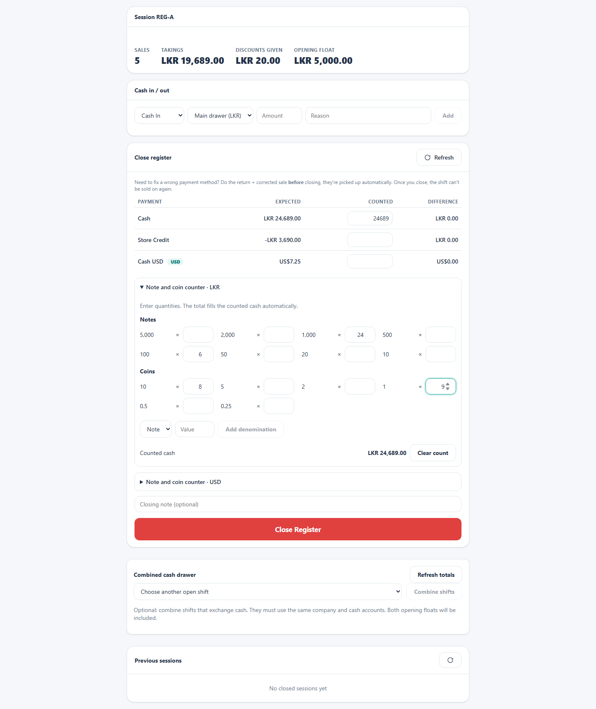
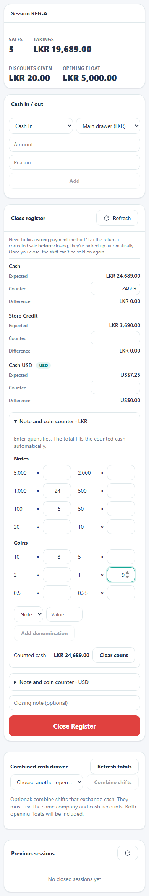
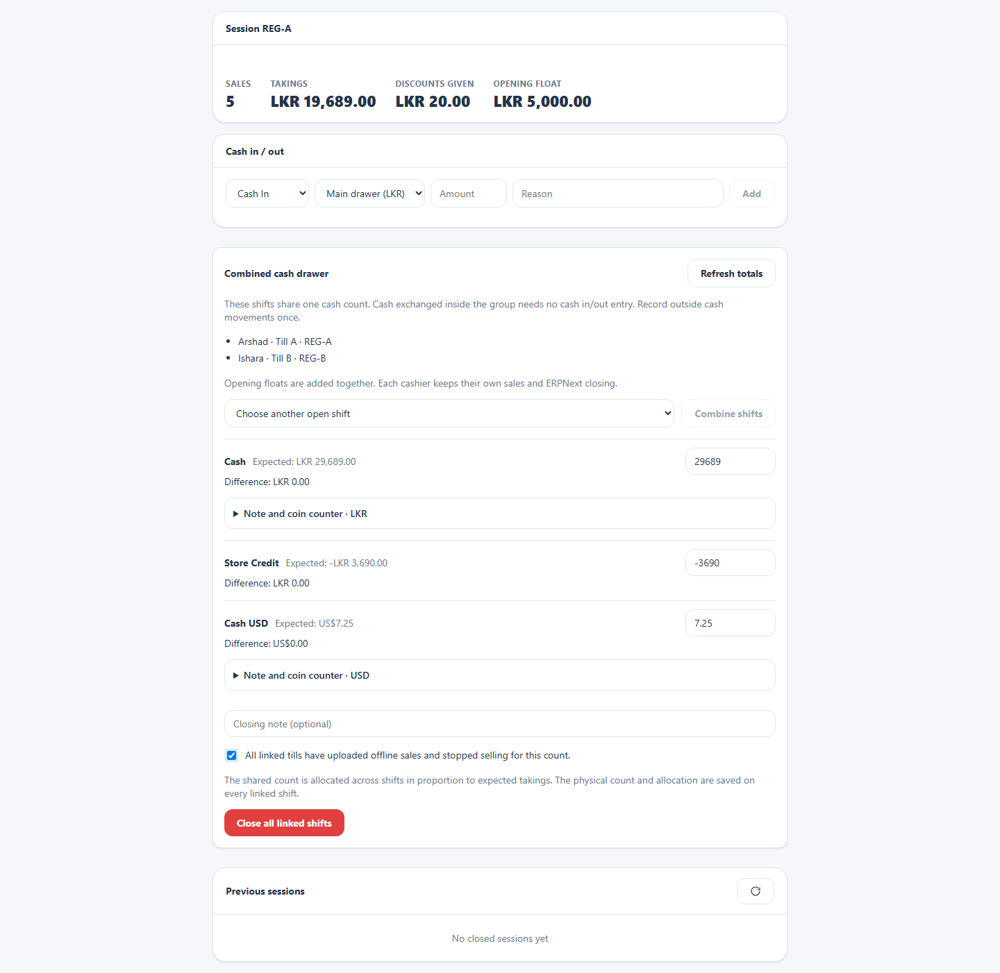
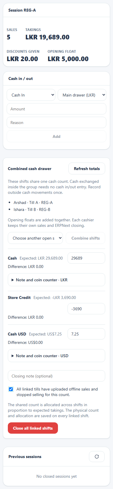

# Cash counting, combined drawers and default loyalty

## Count notes and coins at closing

Open **Register → Close register → Note and coin counter**. Each cash payment method gets its own counter in that drawer's currency. Enter the quantity of each note and coin; the total fills **Counted** automatically. Card, store-credit and other non-cash payment methods keep their normal amount fields.

The counter includes currency presets for LKR, USD, EUR, GBP, INR, AED, SAR, AUD, CAD, JPY, SGD, KWD, BHD, QAR, OMR, PKR and MVR. Use **Add denomination** for other currencies, older notes or an additional coin. Quantities must be whole and non-negative. Editing **Counted** directly clears that drawer's denomination breakdown. **Clear count** resets its quantities and counted amount to zero.

The server checks the currency, quantities and total before accepting the close. The original breakdown is saved in **POS Register Session → Note and Coin Count**. Configured empty cash drawers can also be counted. Existing drawer reconciliation rounds monetary totals to two decimal places, including currencies whose smallest coins are below one cent.

## Combine shifts that exchange cash

A System Manager or EsafePOS Manager opens **Register → Combined cash drawer**, chooses a compatible open shift, and presses **Combine shifts**. A manager without their own open shift can first choose **Close this shift** under **Other open shifts here** to reach the same controls. Up to 20 shifts can share one group, including shifts on different POS Profiles.

All linked shifts must belong to the same company and use the same main cash payment method, foreign-currency cash methods and cash ledger accounts. The manager must have access to every participating POS Profile. Cashiers see group membership and closing status from their own assigned till; detailed combined financial figures remain with the manager. In ERPNext 16, each concurrently open POS Invoice register still needs its own POS Profile; linking drawers preserves that native restriction.

Both opening floats are included. If both cashiers were previously treating the same physical float as their own opening float, correct that accounting before linking; entering a smaller count cannot correct duplicated opening money. After linking, cash exchanged **inside** the group stays inside the combined balance. Record an outside cash receipt or payout once on the shift that handled it. Existing cash-out permissions and approval rules still apply.

The group is linked until closing; it is not an invoice merge and does not move sales, customers, stock or accounting entries between cashiers. Link only shifts that should end together. Linked sessions cannot be closed or cancelled individually.

The Register page checks the group every ten seconds. New sales, customer payments, cash movements or membership changes flag the displayed closing figures as stale. **Refresh totals**, then re-check the count. A close also checks its snapshot on the server while holding the member shift locks.

Before closing, upload offline sales on **every** linked till and stop selling. Browser queues live on their own devices; the server cannot upload a different device's queue. The manager confirms that the tills are ready, enters the combined amount for every payment method and counts each cash currency once, then presses **Close all linked shifts**. The local till also blocks closing while it has uploadable queued sales.

Every member becomes unsellable in the same database commit. Each retains its original ERPNext Opening/Closing Entry and existing retry/self-healing consolidation. **Previous sessions** labels its counts as allocated and links to the saved physical count and allocation in ERPNext. A failed native consolidation can be retried from the usual session history.

The physical count is allocated proportionally to each shift's positive expected cash, with an exact rounding remainder. Non-cash methods preserve signed expected balances and allocate only the difference. These are allocations of one physical count, not independent cashier cash counts. The aggregate variance is checked once against the shop's reason policy and produces one manager alert. Every member stores the same group count, denominations, expected figures, allocation, member list and counting user in **Combined Drawer Closing Count**.

## Default loyalty enrollment

Deploy the changes and run `bench --site <site> migrate`. Setup enables ERPNext's loyalty switch where available and provisions an unrestricted **Auto Opt In** program for each company with an enabled POS Profile. It reuses an eligible program where possible. For an LKR company, the default must convert one point to one LKR so the existing **Save change as points** flow works.

If a new program is needed, it is named **EsafePOS Rewards - <company>**, uses the company's cost center and a loyalty expense account, and starts with one purchase point per 100 currency units, one currency unit per point and a 365-day point expiry. Managers can adjust collection and expiry rules in ERPNext. Existing programs' conversion rates and collection rules are retained. Missing company cost-center/account setup is logged and retried on a later migration; the checkout explains why saving change is unavailable until configuration is valid.

Existing and future customers without an explicit membership automatically use the active company default in the POS wallet and checkout, including purchase rewards. No bulk Customer rewrite is required. Explicit customer memberships and existing points are preserved; a program from another company is not redeemed in this company. Existing LKR, online-only, named-customer, funding and accounting validation rules for saving change remain enforced. After the initial setup, later migrations respect administrator changes to the loyalty switch and program configuration.

The resolver follows ERPNext's [Auto Opt In and eligibility fields](https://github.com/frappe/erpnext/blob/version-15/erpnext/accounts/doctype/loyalty_program/loyalty_program.json) and [native enrollment model](https://github.com/frappe/erpnext/blob/version-15/erpnext/selling/doctype/customer/customer.py).

## Verification and deployment

Standalone checks: `python -m unittest esafepos.test_cash_count esafepos.test_shared_drawer esafepos.test_loyalty_defaults esafepos.test_register_closing esafepos.test_loyalty_change` (53 passing tests). The existing credit-checkout suite passes separately (three tests); running it in the same process as the existing saved-change suite exposes their shared import-mock isolation issue. Browser checks: `cd frontend`, then `node register-browser-check.mjs` and `node loyalty-check.mjs`, using the existing isolated Playwright installation. The production build, Python 3.7 grammar, register schema/denomination JSON and diff whitespace checks pass. Rebuild generated assets with `npm run build`.

Browser tests use simulated API responses. After migration, verify an actual two-cashier sale, cash in/out, customer payment and combined close on the site's ERPNext version, including any custom accounting dimensions and native consolidation jobs. No live financial documents were posted during workspace verification.
